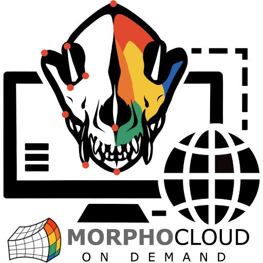

  
  

<h1 align="center">MorphoCloud</h1>

<strong>GPU-enabled cloud workstations for 3D Slicer &amp; SlicerMorph</strong>

MorphoCloud gives you a full desktop for 3D morphometrics and biomedical imaging, running on [Jetstream2](https://jetstream-cloud.org/) and opened in your browser — no local setup. You create and manage your instance and your files from the [MorphoCloud portal](https://portal.morphocloud.org).

## ▶ New here? Start at [**morphocloud.org**](https://morphocloud.org)

1. **[Join](https://join.morphocloud.org)** — sign in with ORCID, then with GitHub, and fill in a short form.
2. **Confirm your email**, then accept the GitHub invitation to the MorphoCloud organization. The welcome email follows from **no-reply@morphocloud.org** (check spam the first time).
3. **[Sign in to the portal](https://portal.morphocloud.org)** with GitHub. The first time, GitHub asks you to authorize the **MorphoCloud Portal** app; press **Authorize**.

## 🚀 Already a member? Everything is on the [portal](https://portal.morphocloud.org)

- **Your storage (MyDrive):** there with or without an instance. Upload and download from **Open my files**.
- **Your instance:** the availability line at the top of the portal shows which instance types are free right now. Choose one that is free and fits your work, and press **Create instance**. An email tells you when it is ready.
- **Connect:** **Web connect** on your instance card opens the desktop in your browser. The card also has the SSH and TurboVNC details.
- **Done for the day?** Press **Shelve**. Press **Unshelve** to continue.

Stuck? Ask the **MorphoCloud Chatbot** on the portal, read the [User Guide](https://github.com/MorphoCloud/docs/tree/main/user-guide), or email [portal@morphocloud.org](mailto:portal@morphocloud.org).

---

NSF- and NIH-funded infrastructure for the morphology research community · Questions? [portal@morphocloud.org](mailto:portal@morphocloud.org)
